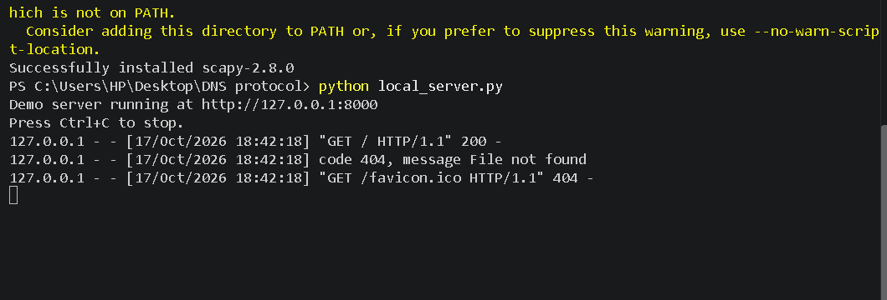
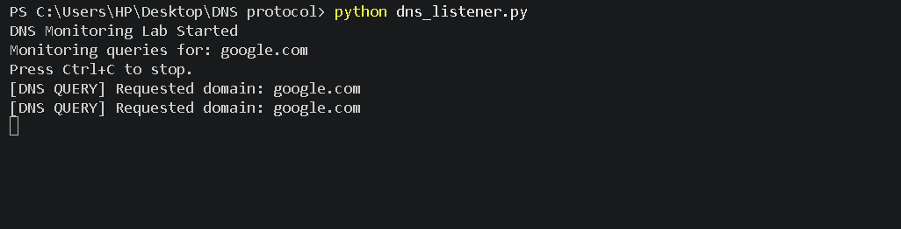

# 🔍 DNS Security Lab — Python & Scapy

A beginner-friendly lab for observing DNS queries with Python and Scapy, running a local demo web server, and learning why DNS integrity matters.

## ✨ Features

- 🔎 Monitors visible DNS queries on UDP port 53 using Scapy.
- 🧪 Filters requests for a configurable test domain (`google.com` by default).
- 🌐 Runs a local HTTP demo page at `http://127.0.0.1:8000`.
- 🛡️ Supports learning about DNS packet structure and defensive security.

## 🧰 Tech Stack

- Python 3
- Scapy
- Npcap (Windows packet capture)
- HTML and CSS
- Python `http.server`

## 📁 Project Structure

```text
DNS-Spoofer/
├── dns_listener.py
├── local_server.py
├── index.html
├── requirements.txt
└── README.md
```

## ⚙️ Installation

1. Install Python 3.
2. On Windows, install **Npcap** if Scapy needs a packet-capture driver.
3. Open PowerShell in the project directory.
4. Install dependencies:

   ```powershell
   python -m pip install -r requirements.txt
   ```

## ▶️ Run the Local Demo Server

Start the web server:

```powershell
python local_server.py
```

Expected startup message:

```text
Demo server running at http://127.0.0.1:8000
Press Ctrl+C to stop.
```

Open `http://127.0.0.1:8000` in your browser. Keep `index.html` in the same folder as `local_server.py`.

### Local server output



The `404` for `/favicon.ico` in the provided screenshot is harmless; the browser requested a favicon that the demo folder does not contain. If the page itself returns `200`, the main request succeeded.

## 🔎 Run the DNS Listener

Open a **second PowerShell window** in the project directory and run:

```powershell
python dns_listener.py
```

Example output from the provided screenshot:

```text
DNS Monitoring Lab Started
Monitoring queries for: google.com
Press Ctrl+C to stop.
[DNS QUERY] Requested domain: google.com
[DNS QUERY] Requested domain: google.com
```

### DNS listener output



The listener only reports DNS queries visible to the computer. On Windows, Scapy may require Npcap and suitable permissions. Only monitor networks and devices you are authorized to test.

## 🖼️ Screenshots

The screenshots are stored in the `screenshots/` directory. Keep these relative paths unchanged when uploading the project to GitHub:

- `screenshots/local-server-output.png`
- `screenshots/dns-listener-output.png`

## 🛡️ Security and Scope

This repository is an educational DNS monitoring lab. The listener shown here observes DNS queries; it does **not** forge DNS replies or redirect other machines. Use an isolated, authorized lab for packet experiments.

Topics to explore:
- DNS queries versus responses
- UDP port 53
- DNSSEC and response integrity
- Secure DNS resolver configuration
- Defensive network monitoring

## 🧯 Troubleshooting

- **`scapy` is not recognized:** Run scripts with `python filename.py`; install dependencies using `python -m pip install -r requirements.txt`.
- **Npcap/capture issue:** Install Npcap from its official source and restart the terminal if needed.
- **Local page returns 404:** Ensure `index.html` is in the same directory where `local_server.py` is running.
- **`favicon.ico` returns 404:** This is usually harmless and does not mean the main page failed.

## 📚 Learning Outcomes

After completing this lab, you should understand basic DNS query inspection, Scapy packet sniffing, local HTTP serving, and common DNS security protections.
